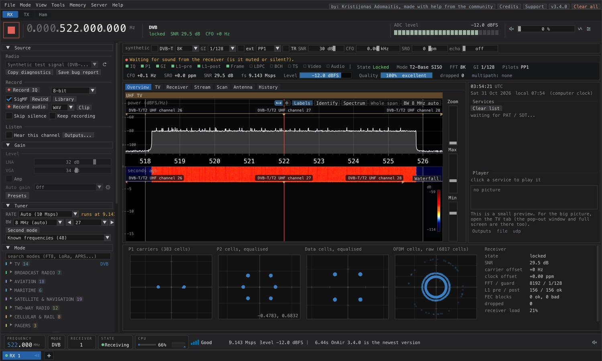
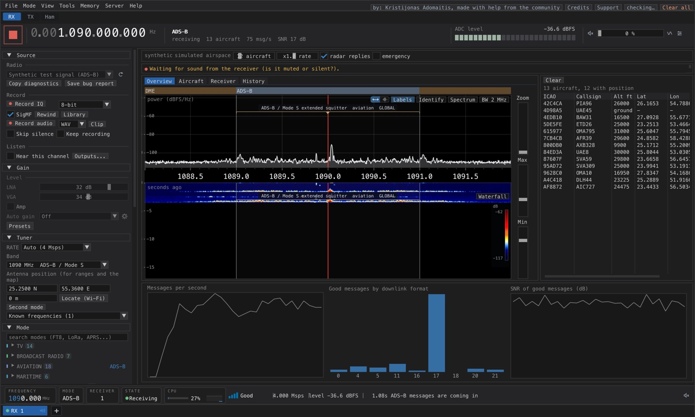
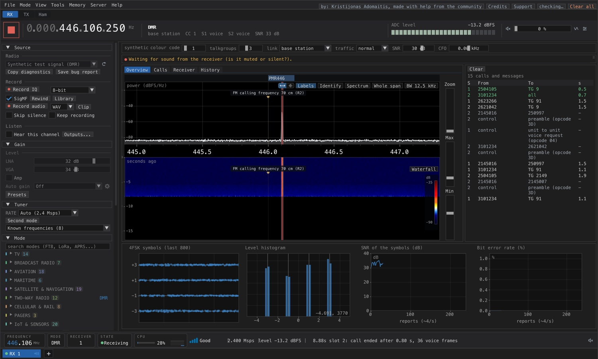
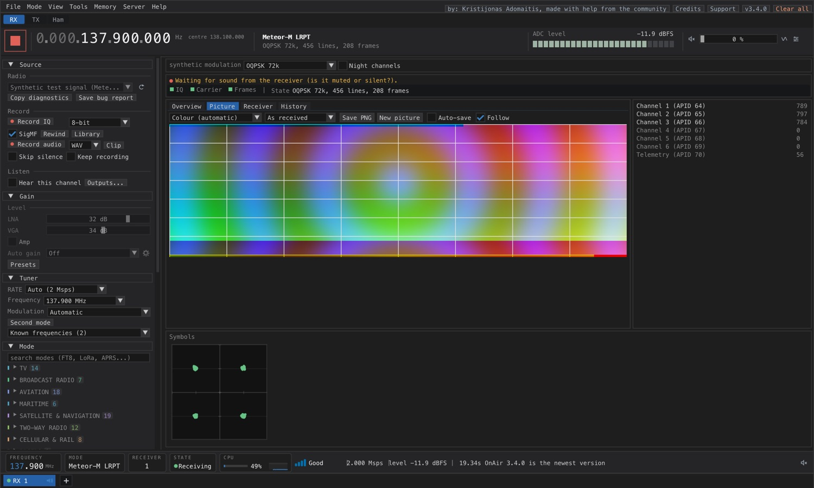
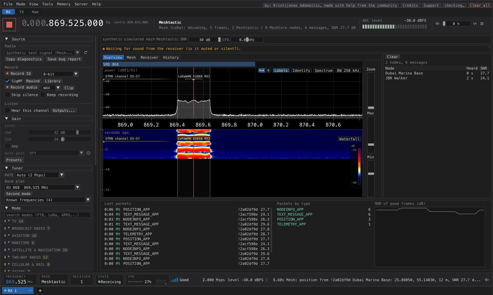
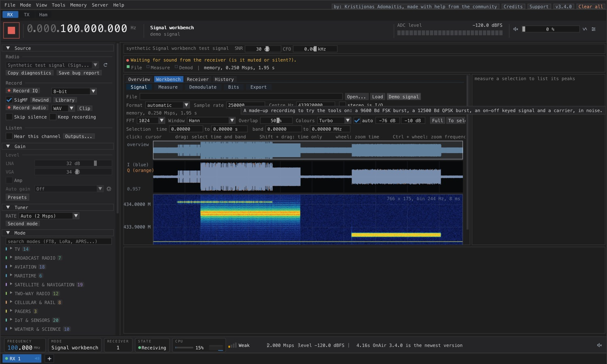
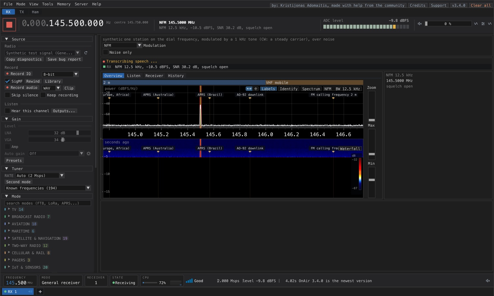
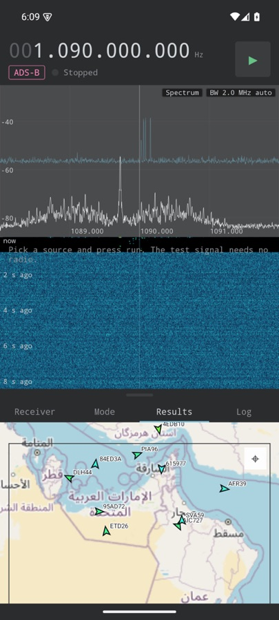
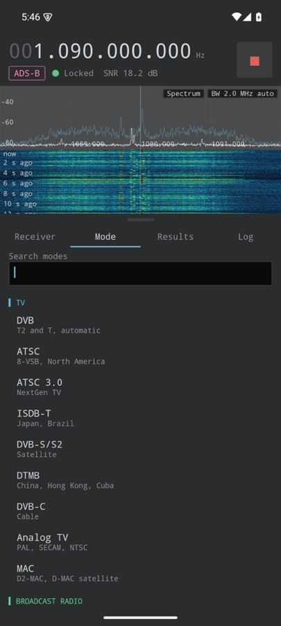

<p align="center"></p>

<h1 align="center">OnAir</h1>

<p align="center"><b>Receive TV, radio, aircraft, ships, satellites, two-way radio, pagers, time signals and more: <!-- modecount -->158<!-- /modecount --> modes with one software-defined radio.</b><br>
Free and open source, for macOS, Windows, Linux and Android.</p>

<p align="center">
  <a href="https://github.com/adswill/OnAir/releases/latest"></a>
  <a href="https://github.com/adswill/OnAir/releases"></a>
  <a href="https://github.com/adswill/OnAir/stargazers"></a>
  <a href="https://github.com/adswill/OnAir/actions/workflows/ci.yml"></a>
  <a href="https://app.codacy.com/gh/adswill/OnAir/dashboard?branch=0.2.7"></a> <!-- swap for the dynamic badge: Codacy > Repository settings > General > Badges (Markdown) -->
  
  <a href="LICENSE"></a>
  <a href="https://on-air.dev"></a>
  <a href="https://discord.gg/Kky9c6atm"></a>
</p>


<p align="center">
  <a href="https://github.com/adswill/OnAir/releases/latest"><b>Download</b></a> &nbsp;·&nbsp;
  <a href="https://on-air.dev"><b>Website</b></a> &nbsp;·&nbsp;
  <a href="https://on-air.dev/docs/"><b>Docs</b></a> &nbsp;·&nbsp;
  <a href="https://discord.gg/Kky9c6atm"><b>Discord</b></a> &nbsp;·&nbsp;
  <a href="https://files.on-air.dev"><b>Signal samples</b></a> &nbsp;·&nbsp;
  <a href="https://map.on-air.dev"><b>Live map</b></a> &nbsp;·&nbsp;
  <a href="https://github.com/adswill/OnAir-channels"><b>Channel list</b></a> &nbsp;·&nbsp;
  <a href="https://github.com/adswill/OnAir/releases/download/v0.2.7/OnAir_promo_v0.2.7.mp4"><b>Overview video</b></a>
</p>

<p align="center"><a href="docs/img/main.jpg"></a></p>

<p align="center"><a href="https://ko-fi.com/adswill"></a></p>

## What is OnAir

OnAir turns a low-cost SDR (a HackRF, an RTL-SDR, an Airspy and many other radios) into a receiver for most of what is on the air. Plug in an antenna, pick a mode, and watch what happens inside.

- **Many modes, one app:** <!-- modecount -->165<!-- /modecount --> modes, from TV and DAB+ to ADS-B, AIS, DMR, satellite weather, LoRa and Meshtastic, amateur digital modes and more ([list](#supported-modes)).
- **Honest and visible:** the spectrum, the sync, the error correction and the decoded data are on screen, with one quality score and an echo detector.
- **Easy to start:** a built-in **Tour** with demo signals needs no radio; one-button gain tuning, a channel scanner and saved memories.
- **Free and open source** (GPL-3.0-or-later) for macOS, Windows, Linux and Android. Receive first: transmit is off by default, behind a licence notice ([Transmit](docs/REFERENCE.md#transmit)).

> [!TIP]
> New here? Press **Tour** in the app: a little TV walks you through OnAir with a built-in demo signal, so you can explore everything before you buy a radio.

## Contents

[Gallery](#gallery) · [Supported modes](#supported-modes) · [Supported hardware](#supported-hardware) · [Install](#install) · [Quick start](#quick-start) · [Build from source](#build-from-source) · [Voice codecs](#voice-codecs-user-installed) · [Highlights](#highlights) · [Community](#support-and-community) · [Contributing](#contributing) · [Licence and credits](#license) · [Full reference](docs/REFERENCE.md)

## Gallery

<div align="center">

<table>
<tr>
<td align="center" width="33%"><a href="docs/images/dvb-t2-tv.jpg"></a><br><sub>DVB-T2 TV: lock, constellations, receiver stats</sub></td>
<td align="center" width="33%"><a href="docs/images/adsb-map.jpg"></a><br><sub>ADS-B: aircraft, message rates, SNR</sub></td>
<td align="center" width="33%"><a href="docs/images/dmr-calls.jpg"></a><br><sub>DMR: call log, 4FSK symbols, BER</sub></td>
</tr>
<tr>
<td align="center"><a href="docs/images/meteor-lrpt.jpg"></a><br><sub>Meteor-M LRPT satellite weather (test pattern)</sub></td>
<td align="center"><a href="docs/images/meshtastic-lora.jpg"></a><br><sub>Meshtastic / LoRa: nodes and packets</sub></td>
<td align="center"><a href="docs/images/signal-workbench.jpg"></a><br><sub>Signal workbench: analyse a recording</sub></td>
</tr>
<tr>
<td align="center"><a href="docs/img/fm.jpg"></a><br><sub>FM with RDS and Listen</sub></td>
<td align="center"><a href="docs/img/ais.jpg"></a><br><sub>AIS ships on the map</sub></td>
<td align="center"><a href="docs/images/general-receiver.jpg"></a><br><sub>General receiver: NFM, AM, SSB, WFM</sub></td>
</tr>
<tr>
<td align="center"><a href="docs/img/dab.jpg"></a><br><sub>DAB+ ensemble</sub></td>
<td align="center"><a href="docs/img/touch.jpg"></a><br><sub>Touch interface</sub></td>
<td align="center"><a href="docs/images/android-adsb.jpg"></a> <a href="docs/images/android-modes.jpg"></a><br><sub>Android app</sub></td>
</tr>
</table>

<sub>Screenshots use the built-in test signals and demo data, so no radio is shown. Click one to enlarge.</sub>

</div>

## Supported modes

<!-- modes-table:begin -->
| Family | Modes | What you get |
|---|:---:|---|
| **TV** | 14 | DVB-T/T2/S/S2/C, ATSC 1.0 / 3.0, ISDB-T/S, DTMB, analogue TV, FPV video; live player, recording, EPG |
| **Broadcast radio** | 7 | DAB+, DRM, HD Radio, CDR, AM, C-QUAM, FM with RDS |
| **Aviation** | 18 | ADS-B map, Mode A/C, UAT, ACARS, VDL2, HFDL, airband, VOR / ILS, FLARM, drones |
| **Maritime** | 6 | AIS, VDES, NAVTEX, DSC, weather fax, marine VHF voice |
| **Satellite and navigation** | 19 | Weather pictures, Iridium, Inmarsat, Orbcomm, QO-100, CubeSats, GNSS, SBAS, COSPAS-SARSAT, Argos |
| **Two-way radio** | 12 | DMR, P25 with trunking follower, NXDN, dPMR, D-STAR, M17, TETRA, tone decoders |
| **Cellular and rail** | 6 | LTE / 5G NR / NB-IoT cells, GSM-R, LBJ, KLW, TDCS |
| **Pagers** | 3 | POCSAG, FLEX, Multitone |
| **IoT and sensors** | 20 | ISM sensors, LoRaWAN, Meshtastic, MeshCore, BLE, Zigbee, Wi-Fi, Z-Wave, DECT, NFC |
| **Weather and science** | 9 | Radiosondes, Horus balloons, SAME, time signals, radio astronomy, meteor scatter |
| **Amateur** | 35 | FT8, FT4, WSPR, JS8Call, RTTY, PSK, MT63, SSTV, FreeDV, APRS, LoRa APRS, MeshCom |
| **HF utility** | 6 | ALE, beacons, Datawell buoys, CODAR |
| **Tools** | 4 | General receiver, spectrum analyser, spectrum explorer, signal workbench |
| **KA family (own modes)** | 6 | KAAL, KAPP, KAFT, KAVB, KAIT, KAWS: own digital modes, in development |
<!-- modes-table:end -->

Every receiver is built from the published specifications and tested on generated signals (carrier offsets, noise, echoes, clock errors) and, where recordings exist, on real captures. **Receive only** means nothing is transmitted, decrypted or joined. Caveats per mode are in the [full mode list](docs/REFERENCE.md#modes); mode numbering is in [docs/MODE-NUMBERS.md](docs/MODE-NUMBERS.md). Mode names below come from the app's mode list.

<details>
<summary><b>TV</b> (14)</summary>

DVB · TV (auto) · ATSC · ATSC 3.0 · ISDB-T · DVB-S/S2 · Internet TV (IPTV) · TV sat beacon decoder · DTMB · ISDB-S (BS) · DVB-C · Analog TV · FPV video (analog) · MAC
</details>

<details>
<summary><b>Broadcast radio</b> (7)</summary>

DAB / DAB+ · FM · DRM · HD Radio · AM broadcast · AM stereo (C-QUAM) · CDR
</details>

<details>
<summary><b>Aviation</b> (18)</summary>

ADS-B · Mode S uplink · Mode A/C · ACARS · VDL2 · VDL4 · HFDL · Airband · VOR · ILS · NDB · Drone Remote ID · UAT · FLARM · DJI drones · DME (WIP) · eLoran / Loran-C (WIP) · ASTERIX
</details>

<details>
<summary><b>Maritime</b> (6)</summary>

AIS · VDES · NAVTEX · DSC · Weather fax · Marine VHF
</details>

<details>
<summary><b>Satellite and navigation</b> (19)</summary>

GNSS · DGPS beacon (WIP) · Inmarsat-C · Inmarsat Aero · Iridium · Meteor-M LRPT · GOES HRIT · Elektro-L · COSPAS-SARSAT 406 MHz · Argos · Orbcomm · QO-100 · CubeSat telemetry · Globalstar · GOES DCS · SBAS · LoRa satellites · PSK demodulator (experimental) · Inmarsat (all carriers)
</details>

<details>
<summary><b>Two-way radio</b> (12)</summary>

DMR · Digital voice (auto) · NXDN · P25 · P25 Phase 2 · dPMR / PMR446 · Tone decoders (CTCSS, DCS, DTMF, selcall) · TETRA · TETRAPOL · MPT1327 trunking (WIP) · LTR trunking (WIP) · EDACS trunking (WIP)
</details>

<details>
<summary><b>Cellular and rail</b> (6)</summary>

Cell towers · 5G NR cells · NB-IoT cells · GSM-R · LBJ · EBICab / Eurobalise (needs a user test)
</details>

<details>
<summary><b>Pagers</b> (3)</summary>

POCSAG · FLEX · Multitone Paging
</details>

<details>
<summary><b>IoT and sensors</b> (20)</summary>

ISM sensors · LoRaWAN · Meshtastic · MeshCore · Bluetooth LE · BLE tracker detector · Zigbee / 802.15.4 · Wi-Fi HaLow (802.11ah) · ANT+ sensors · DECT cordless phones · Wi-SUN FAN · Wireless M-Bus (meters) · NFC / RFID 13.56 MHz · Z-Wave · LoRa (raw) · Sigfox · Wi-Fi networks · LoRaWAN (all channels) · nRF24L01 (needs a user test) · Flipper Zero Sub-GHz chat
</details>

<details>
<summary><b>Weather and science</b> (9)</summary>

HRPT / AHRPT · NOAA Weather Radio SAME · Radiosonde · Time signals · e-Czas (225 kHz, Poland) · Meteor scatter · Ionospheric sounders · Radio astronomy · SSDV pictures
</details>

<details>
<summary><b>Amateur</b> (35)</summary>

FT8 · FT4 · FT2 · WSPR · JT65 · JT9 · Q65 · FST4 · MSK144 · JT4 · PSK31 · MT63 · FSQ · IFKP · SITOR (WIP, table unverified) · ARDOP · JS8Call · RTTY · CW · SSTV · HamDRM · Olivia · Contestia · MFSK · THOR · DominoEX · Hellschreiber · ROS (HF) · FreeDV · M17 · D-STAR · Yaesu Fusion (WIP) · APRS (AFSK) · LoRa APRS · MeshCom
</details>

<details>
<summary><b>HF utility</b> (6)</summary>

Datawell Buoy HF Link · CODAR / HF ocean radar · HF ALE · HF waveform ID · HF beacons · PACTOR-I (experimental)
</details>

<details>
<summary><b>Tools</b> (4)</summary>

Signal workbench · General receiver · Spectrum explorer · Spectrum analyser
</details>

<details>
<summary><b>KA family (own modes)</b> (6)</summary>

KAAL · KAVB · KAIT · KAPP · KAFT · KAWS
</details>

## Supported hardware

| Radio | Wide TV channels (6 - 8 MHz) | DAB, FM and narrow channels |
|---|:---:|:---:|
| **HackRF One / Pro** (the radio OnAir is developed with) | yes | yes |
| **BladeRF**, **LimeSDR** (USB, Mini, Mini 2), **USRP**, **Fobos SDR**, **RX888 MkII**, **Icom IC-R8600** (I/Q OUT), **RFNM** | yes | yes |
| **PlutoSDR** | about 4 Msps over USB, too little | yes |
| **Airspy R2**, **SDRplay RSP** (needs the [SDRplay API](https://sdrplay.com/hardware-api/)) | should work | yes |
| **RTL-SDR** (also Blog V4 / V4 Lite) | no | yes |
| **Airspy HF+** | no | narrow channels only |
| Network: rtl_tcp, SoapyRemote, SpyServer, SDR++ server, KiwiSDR, nRSP-ST, TCI, Hermes Lite 2, Red Pitaya | per radio | per radio |
| Sound card, Hamlib rig, anything else through [SoapySDR](https://github.com/pothosware/SoapySDR) | depends | depends |

A TV channel needs about 1 million samples per second per MHz of channel width. OnAir never limits the frequency you enter; ranges are what a radio is *specified* for. Radios other than the HackRF have had less real-world testing: notes, firmware and driver details per radio are in **[DEVICES.md](DEVICES.md)**, the full table and network radio setup in the [reference](docs/REFERENCE.md#supported-radios).

## Install

Download the file for your system from the **[latest release](https://github.com/adswill/OnAir/releases/latest)**. There is nothing to compile.

| | **macOS** 15+ | **Windows** 10 / 11 | **Linux** | **Android** 9+ |
|---|---|---|---|---|
| **File** | `OnAir-...-macos-arm64.dmg` (Apple silicon)<br>`OnAir-...-macos-x86_64.dmg` (Intel, AVX2) | `OnAir-...-windows-x64-setup.exe`<br>or `OnAir-...-windows-x64.zip` (AVX2) | `onair_..._amd64.deb` / `_arm64.deb`<br>or `onair-...-portable.tar.gz` | `OnAir-...-android.apk` (arm64) |
| **Get it** | [latest release](https://github.com/adswill/OnAir/releases/latest) | [latest release](https://github.com/adswill/OnAir/releases/latest) | [latest release](https://github.com/adswill/OnAir/releases/latest) | [latest release](https://github.com/adswill/OnAir/releases/latest) |
| **Install** | Open the `.dmg`, drag OnAir to Applications. Not signed with a developer certificate yet: right-click, *Open* on first launch. | Run the installer, or unpack the zip and start `OnAir.exe`. Windows may warn about an unknown publisher (not code-signed). USB drivers: see below. | Debian / Ubuntu: `sudo apt install ./onair_<version>_<arch>.deb`, then `onair`. Other distributions: unpack the archive, run `bin/onair`. The `.deb` carries its own video decoder. | Sideload the APK, see [Android app](#android-app). |

Also: **Docker** (a server without a screen, used from a browser): `docker compose up -d --build` in [packaging/docker](packaging/docker/README.md), then open `https://<server>:3001`. Release files are listed with checksums (`SHA256SUMS`) on the release page.

> [!NOTE]
> **SDRplay RSPs (RSP1, RSP1A, RSP1B, RSP2, RSPduo, RSPdx):** install the free **[SDRplay Hardware API](https://sdrplay.com/hardware-api/)** once, separately from SDRconnect, and restart OnAir. OnAir loads SDRplay's own library and service; it does not bundle them. Make sure the "SDRplay API Service" is running (the installer starts it). For the RSPduo, select the input with the antenna: **Tuner 1**, **Tuner 2**, or **Tuner 1 Hi-Z**. OnAir uses one tuner at a time, at 62.5 kS/s to 10 MS/s; see [tested features and limits](DEVICES.md#sdrplay-rspduo). An RSP-compatible radio not made by SDRplay (for example a Mirics MSi2500 "RSP1A clone") is not seen by the SDRplay API; use SoapySDR's `mirisdr` module instead.

> [!IMPORTANT]
> **Windows USB drivers:** for a HackRF, RTL-SDR, Airspy, Airspy HF+, Fobos SDR or RX888 MkII (its boot loader 04b4:00f3 and its running firmware 04b4:00f1 both need it), install the WinUSB driver once with [Zadig](https://zadig.akeo.ie). A LimeSDR Mini needs FTDI's FT60x driver (see the README inside the download). A LimeSDR-USB (Cypress FX3) needs the Cypress/LimeSuite USB driver (CyUSB3, the one LimeGUI installs), not WinUSB: do not replace it with Zadig. OnAir's own LimeSuite has no FX3 support, so for a LimeSDR-USB also install [PothosSDR](https://downloads.myriadrf.org/builds/PothosSDR/) or LimeSuite; OnAir finds its LimeSuite.dll by itself and the log (onair.log) says which copy saw the radio ("LimeSuite ...: N radio(s)").


### Android app

<details>
<summary><b>The Android app: sources, limits, how to install</b></summary>

The Android app is the desktop decoder core (the same C++ code, built as `libonair.so`) with a phone interface in Kotlin Compose: spectrum and waterfall, the mode list with search and groups, a results tab with the decoded data of the selected mode, and a log.

- **Receive only.** The app never transmits. Its only permission is INTERNET (for rtl_tcp and SpyServer, and for map tiles).
- **Sources:** an RTL-SDR on the USB port (0.2.7), `rtl_tcp` (an RTL-SDR served over the network, or on the phone itself), SpyServer, an IQ file (cs8, cu8, cf32, ci16, cu16, with its sample rate) and a built-in test signal for the selected mode that needs no radio.
- **Results:** per-mode results (cards and tables), an OpenStreetMap map (tiles are only fetched after you agree), and FM with RDS.
- **Use it:** pick a source on the Receiver tab, a mode on the Mode tab, press play. Tap the spectrum to tune, drag to move, pinch to zoom (double tap resets).
- **Install:** download `OnAir-…-android.apk` from the [release](https://github.com/adswill/OnAir/releases/latest), copy it to the phone, open it and allow installs from unknown sources for the app you opened it with. The APK is signed with the project's own key, not a Play Store key; updating later needs the same key.
- **Limits:** arm64-v8a only, Android 9 (API 28) or newer. Direct USB works for RTL-SDR radios (new in 0.2.7); HackRF and Airspy USB are not supported yet, so use rtl_tcp or SpyServer for those. No vocoder voice (DMR, P25, NXDN, D-STAR, TETRA), no TV video or sound, and no images yet (the satellite pictures and the SSTV / fax pictures). Wide modes (DVB, ATSC) need a fast phone.
</details>

### Development version ("nightly")

Fixes and new features land on the `main` branch first, before they go into a release. To try them early, [build OnAir from source](#build-from-source) from the latest `main`.

> [!WARNING]
> The development version is **not tested like a release**. It can contain bugs, unfinished features or changes that stop parts of the app (or the whole app) from working. Use the [latest release](https://github.com/adswill/OnAir/releases/latest) for everyday use, and if something breaks in a development build, please say so on [Discord](https://discord.gg/Kky9c6atm) or in [GitHub Issues](https://github.com/adswill/OnAir/issues), mentioning the commit you built.

## Quick start

1. **Connect** your radio and antenna, then start OnAir. Connected radios appear in the source menu.
2. **Pick a mode** in the mode list (or search by name).
3. **Tune:** enter a frequency, or open the **Scan** tab to find channels automatically.
4. **Press Start.** When the receiver locks, the channels appear on the right: click one to watch or listen.
5. **Improve reception:** use **Auto-tune** for the gain, or **Optimise gain** (sweeps the gain range, measures the mode's SNR and keeps the lowest gain within 0.5 dB of the best that does not overload the ADC; **Undo gain** goes back), and watch the quality score while you move the antenna. Height and a clear view toward the transmitter matter more than anything else.

No radio? Open an IQ recording through the *IQ recording file* source (cs8, cu8, cf32, ci16, cu16, SigMF and two-channel WAV IQ files), or press **Tour**. Real recordings are in the [signal sample library](https://files.on-air.dev).

## Build from source

<details>
<summary>Build instructions</summary>

You need a C++20 compiler, CMake 3.20 or newer, **Rust (cargo and rustc 1.70 or newer; required since 0.2.7, the protocol layers are Rust)**, pkg-config, FFmpeg, libhackrf, and GLFW for the app. SoapySDR is optional. For a cross build install the Rust target first (`rustup target add <triple>`); CMake names it when it is missing.

```sh
# macOS
brew install cmake rust pkg-config hackrf soapysdr libusb ffmpeg glfw
# Debian / Ubuntu
sudo apt install build-essential cmake cargo pkg-config libhackrf-dev libsoapysdr-dev libusb-1.0-0-dev \
  libglfw3-dev libavformat-dev libavcodec-dev libavutil-dev libswscale-dev libswresample-dev

cmake -S . -B build -DCMAKE_BUILD_TYPE=Release -DDECT2_BUILD_APP=ON
cmake --build build -j "$(getconf _NPROCESSORS_ONLN)"   # one job per core (a bare -j starts hundreds and can run out of memory)
ctest --test-dir build          # run the test suite
```

The app is `build/dect2`. Without a radio, open an IQ recording through the *IQ recording file* source, or run the command-line receiver on it:

```sh
build/dect2cli --file capture.cs8 --rate 10 --format cs8 --play <service id>
```

SigMF (`.sigmf-meta` / `.sigmf-data`) and two-channel WAV IQ files open the same way and describe their own sample rate, centre frequency, format and start offset; `--rate`, `--format` and `--freq` still override.

**Tuning for your own CPU.** Release programs are built for the baseline 64-bit PC (the hot loops pick AVX2 at run time). A binary you build yourself can use everything your CPU offers:

- `-DDECT2_WIN_AVX2=ON` (x86-64 on Windows and Intel Macs): the whole receiver for AVX2 + FMA; refuses to start on older CPUs.
- `-DCMAKE_CXX_FLAGS="-march=native"` (GCC or Clang): runs only on CPUs like yours.
- `-DDECT2_PORTABLE=ON` (macOS, plain C++ instead of Accelerate) and `-DDECT2_NO_SIMD=ON` go the other way, for unusual CPUs, and are slower.

Configure with a clean `build` folder after changing these. Other options in `CMakeLists.txt`: `DECT2_UI_BACKEND` (Metal or OpenGL3), `DECT2_WITH_SOAPY`, `DECT2_WITH_RFNM` (when librfnm is installed: [DEVICES.md](DEVICES.md)).

**Windows** (10 or 11, 64-bit), step by step:

1. Install [MSYS2](https://www.msys2.org) with its default settings, and open **MSYS2 UCRT64** (not MINGW64: it has no HackRF and SoapySDR packages).
2. Update MSYS2 with `pacman -Syu` (if the window closes, open UCRT64 again and run it a second time).
3. Install the tools and libraries:
   ```sh
   pacman -S --needed git zip mingw-w64-ucrt-x86_64-{gcc,cmake,ninja,pkgconf,ffmpeg,glfw,hackrf,soapysdr,libiconv}
   ```
   Optional: `mingw-w64-ucrt-x86_64-nsis` for the setup .exe. (codec2 is built from `third_party/codec2` with OnAir and goes into the zip.)
4. Get the source and build:
   ```sh
   git clone https://github.com/adswill/OnAir.git
   cd OnAir
   cmake -S . -B build -G Ninja -DCMAKE_BUILD_TYPE=Release -DDECT2_BUILD_APP=ON
   cmake --build build
   ```
5. Run it from the same shell, so Windows finds the DLLs: `./build/dect2.exe`. Tests: `ctest --test-dir build`.
6. For a folder that runs on any PC, with all DLLs next to `OnAir.exe`, run `tools/package/make_windows.sh`: a portable zip in `build-windows/`, plus a setup .exe if NSIS is installed. From macOS or Linux, `tools/package/make_windows_cross.sh` builds the same package with a cross-compiler.

To use a HackRF, RTL-SDR or Airspy, install the WinUSB driver once with [Zadig](https://zadig.akeo.ie).

**macOS app and disk image:** run `tools/package/make_dmg.sh`. It targets macOS 15.0 by default (override with `MACOSX_DEPLOYMENT_TARGET`); every bundled library must support that version, and packaging stops if any executable or library requires a newer macOS.

**Project layout**

| Folder | Contents |
|---|---|
| `core/` | The receiver library: demodulators, error correction, transport stream, player, network tuner |
| `app/` | The graphical application |
| `tools/` | Command-line receiver and scanner, plus the packaging scripts |
| `tests/` | Unit tests and benchmarks |
| `packaging/` | Linux and Windows installer resources, Docker |
</details>

## Voice codecs (user-installed)

OnAir ships no patented codecs. **codec2** (FreeDV and M17 speech) comes with the app as a separate library. The voice of **DMR, P25, NXDN, dPMR and D-STAR** (AMBE / IMBE, via mbelib) and **HD Radio** sound (HDC) are silent until you install the codec yourself; calls, IDs, stations and data work without it. The **?** next to the sound of each such mode has an **Open codecs folder** button; press **Look again** after you add the library. Steps and the legal notes: **[docs/CODECS.md](docs/CODECS.md)**. Decryption only with keys you import yourself ([docs/KEYS.md](docs/KEYS.md)).

## Highlights

| | |
|---|---|
| **OnAir Web** | Share a radio with many listeners from a browser, WebSDR style, with the headless `onair-server`: [docs/ONAIR-WEB.md](docs/ONAIR-WEB.md), [headless server](docs/headless-server.md), [host a receiver](docs/HOST-A-RECEIVER.md). |
| **Integrations** | Remote-control HTTP / WebSocket API (off by default), data feeds (ADS-B SBS-1 and Beast, AIS NMEA, APRS-IS, ACARS / VDL2 JSON and more), Hamlib rigs, plug-ins and automation: [Remote API](docs/REMOTE-API.md), [plug-ins](docs/plugins.md), [reference](docs/REFERENCE.md#remote-control-api). |
| **Reception help** | A single quality score, an echo (multipath) detector, **Auto-tune** and **Optimise gain**, a direction finder and a pass planner for satellites, and **Save bug report** for one-zip diagnostics. |
| **Tools** | [Signal workbench](docs/REFERENCE.md#tools-and-notes), [Mode Builder](docs/MODE-BUILDER.md), [Antenna designer](docs/ANTENNA.md), spectrum analyser, memories, scanner. |
| **Updates** | Checks GitHub on start, verifies the SHA-256, installs on close; all optional: [reference](docs/REFERENCE.md#updates). |
| **More** | Per-topic user guides are indexed in [docs/README.md](docs/README.md); what changed per release: [3.3](docs/CHANGELOG-3.3.md), [3.2](docs/CHANGELOG-3.2.md), [3.1](docs/CHANGELOG-3.1.md), [3.0](docs/CHANGELOG-3.0.md). |

## Support and community

- **[Docs](https://on-air.dev/docs/)**: the wiki, with a page per mode. The [GitHub wiki](https://github.com/adswill/OnAir/wiki) is the same text.
- **[Discord](https://discord.gg/Kky9c6atm)**: support, feature requests, questions, and sharing what you receive.
- **[GitHub Issues](https://github.com/adswill/OnAir/issues)**: bug reports. Attach an IQ recording of the problem: press **Record IQ** in the Source panel (or run `onair-cli --record auto --secs 10`); files go to the `recordings` folder of the app data folder, and **Show recording** opens it. With **SigMF** ticked (the default) every recording also gets a `.sigmf-meta` file, so it opens directly in [IQEngine](https://iqengine.org). **Save bug report** makes one zip with diagnostics, log and crash report.
- **[Signal sample library](https://files.on-air.dev)**: IQ and audio recordings of real signals, shared by users and tagged by mode (for example `#dvb-t2`). Every upload is checked and reviewed before it appears; recordings of the less-tested modes are the most useful.
- **[Pull requests](https://github.com/adswill/OnAir/pulls)** are welcome.

### Buy me a coffee

I'm a bit embarrassed to ask this, but here goes. OnAir is free and always will be. I build it in my spare time, along with the radios, antennas and test equipment it needs. If it's useful to you and you'd like to help, a small tip on **[Ko-fi](https://ko-fi.com/adswill)** really does help and keeps new modes coming. If you'd rather not, that's completely fine: bug reports, recordings and kind words help just as much. Thank you!

<p align="center"><a href="https://ko-fi.com/adswill"></a></p>


## Contributing

[Pull requests](https://github.com/adswill/OnAir/pulls) are welcome. Start with [Discord](https://discord.gg/Kky9c6atm) or an issue if the change is large. Build and test instructions are under [Build from source](#build-from-source); recordings of the less-tested modes help as much as code.

## License

OnAir is released under the **GNU General Public License v3.0 or later**, see [LICENSE](LICENSE).

### Logo

OnAir name and logo © 2026 Kristijonas Adomaitis. All rights reserved; the logo is not covered by the GPL licence of the source code. Designed by Cipta Karsa Studio as work for hire, all rights assigned to the owner (see [assets/branding](assets/branding/README.md)).

## Credits

OnAir stands on the work of many people. Full list with authors, licences and what each licence asks of us: **[THIRD_PARTY.md](THIRD_PARTY.md)** (also in the program: Help, Credits and licences). The main ones:

- **Code in the program:** [Dear ImGui](https://github.com/ocornut/imgui) (Omar Cornut), [miniaudio](https://github.com/mackron/miniaudio) (David Reid), [codec2](https://github.com/drowe67/codec2) (David Rowe, LGPL-2.1, a separate library loaded at run time, see [docs/CODECS.md](docs/CODECS.md)), `dump978` UAT code (Oliver Jowett), the DRA decoder (maliwen2015), the RX888 firmware (Oscar Steila, SDDC_Driver).
- **Decoders written from or ported from open-source receivers:** [nrsc5](https://github.com/theori-io/nrsc5) (HD Radio), [etisnoop](https://github.com/Opendigitalradio/etisnoop) (DAB), [WSJT-X](https://sourceforge.net/projects/wsjt/), JS8Call and fldigi (HF digital modes), [rtl_433](https://github.com/merbanan/rtl_433), [gr-dvbt2](https://github.com/drmpeg/gr-dvbt2), [gr-lora_sdr](https://github.com/tapparelj/gr-lora_sdr), [e-Czas](https://github.com/sp5wwp/e-Czas), [JAERO](https://github.com/jontio/JAERO), acarsdec, libacars, dumphfdl, dumpvdl2, iridium-toolkit, multimon-ng, Meshtastic, MeshCore, MeshCom.
- **Libraries it uses:** [FFmpeg](https://ffmpeg.org), [GLFW](https://www.glfw.org), [libusb](https://libusb.info), [libhackrf](https://github.com/greatscottgadgets/hackrf), [Hamlib](https://hamlib.github.io), SoapySDR.
- **Icom IC-R8600 I/Q driver:** written again in C++ from the MIT work of **Topol in collaboration with AI** (Pawel "Topol" Topolski, the first working SoapySDR module for macOS) and [Pieter Ibelings](https://github.com/ibelinp/ic-r8600-usb-iq) (ic-r8600-usb-iq, MIT). Icom's firmware is Icom's and is not included. Not affiliated with Icom.
- **Data:** map tiles and data (c) [OpenStreetMap](https://www.openstreetmap.org/copyright) contributors, aircraft data from adsbdb, aircraft photos from Planespotters.net with credit, satellite elements from CelesTrak.

- **0.2.8 additions:** the DVB-S / DecSAT work uses code by **Arclamp** (GPL-3.0-or-later); the mesh clock fix is PR #217 by [@ffishman](https://github.com/ffishman); the recommended source for the TETRA and Yaesu Fusion voice plug-ins is [mbelib-neo](https://github.com/arancormonk/mbelib-neo) by arancormonk (GPL-2.0-or-later, not bundled); the NRSC-5 patch for HD Radio sound is from nrsc5 with [FAAD2](https://github.com/knik0/faad2). The KA modes are Kristijonas Adomaitis's own designs.

If your work is used and not credited correctly, please open an issue.

## Contributors

Thank you to everyone who sent fixes, reported bugs, shared recordings, translated or suggested ideas. The full list, with what each person did and for which mode, is in **[CONTRIBUTORS.md](CONTRIBUTORS.md)** (also in the program: Help, Credits, tab Contributors, and in each mode's tooltip). Code contributors: [@0xVANISHED](https://github.com/0xVANISHED), [@A2ureIm4la](https://github.com/A2ureIm4la), [@andriux26](https://github.com/andriux26), [@drelectro](https://github.com/drelectro), [@drfruct](https://github.com/drfruct), [@F5OEO](https://github.com/F5OEO), [@ffishman](https://github.com/ffishman), [@frank-1225](https://github.com/frank-1225), [@modemuser](https://github.com/modemuser), [@MUSTARDTIGERFPV](https://github.com/MUSTARDTIGERFPV), [@peterdewitte](https://github.com/peterdewitte), [@PU2SWX](https://github.com/PU2SWX), [@sbuchweitz](https://github.com/sbuchweitz), [@WispAyr](https://github.com/WispAyr) and [@YZYMC](https://github.com/YZYMC). Want your name changed or removed? Tell us on Discord or open an issue.

---

Business enquiries, press and anything that does not belong in an issue: **kristijonasvr@gmail.com**


