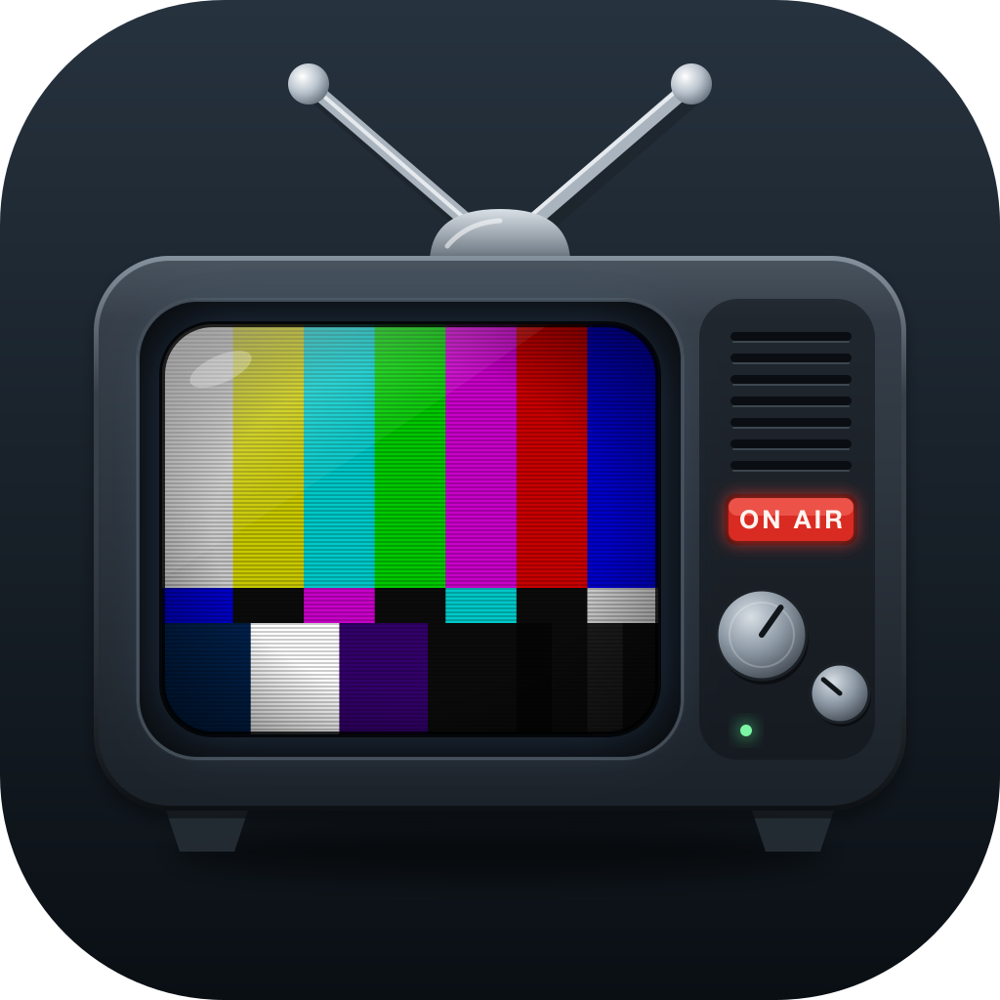

<h1 align="center">OnAir</h1>

<b>Receive TV, radio, aircraft, ships, satellites, two-way radio, pagers, time signals and more: <!-- modecount -->390<!-- /modecount --> modes with one software-defined radio.</b> 
Free and open source, for macOS, Windows, Linux and Android.

  
  
  
  
   <!-- swap for the dynamic badge: Codacy > Repository settings > General > Badges (Markdown) -->
  
  
  
  

  <a href="https://on-air.dev"><b>Website</b></a> &nbsp;·&nbsp;
  <a href="https://on-air.dev/docs/"><b>Docs</b></a> &nbsp;·&nbsp;
  <a href="https://github.com/adswill/OnAir/releases/latest"><b>Download</b></a> &nbsp;·&nbsp;
  <a href="https://github.com/adswill/OnAir/releases/download/v0.2.7/OnAir_promo_v0.2.7.mp4"><b>Overview video</b></a> &nbsp;·&nbsp;
  <a href="https://discord.gg/ptxkzCuzR"><b>Discord</b></a> &nbsp;·&nbsp;
  <a href="https://files.on-air.dev"><b>Signal samples</b></a> &nbsp;·&nbsp;
  <a href="https://map.on-air.dev"><b>Live map</b></a> &nbsp;·&nbsp;
  <a href="https://github.com/adswill/OnAir-channels"><b>Channel list</b></a>

 Spectrum, waterfall and DVB-T constellations, from the built-in test signal. More screenshots: <a href="docs/FEATURES.md">Features</a>.

## What it is

OnAir turns a low-cost software-defined radio (a HackRF, an RTL-SDR, an Airspy and many others) into a receiver for most of what is on the air. Plug in an antenna, pick a mode, and watch the spectrum, the sync, the error correction and the decoded data.

- <!-- modecount -->390<!-- /modecount --> modes in 14 families, from TV and DAB to aircraft, ships, satellites, two-way radio, pagers and sensors.
- Works with HackRF, RTL-SDR, Airspy, SDRplay, BladeRF, LimeSDR, USRP, Pluto and more, plus network radios, sound cards and Hamlib rigs.
- Runs on macOS, Windows, Linux and Android. Free and open source (GPL-3.0-or-later).
- A receiver first. It can also send test signals through a transmit-capable radio into a dummy load (off by default, behind a licence notice; see [Transmit](docs/TRANSMIT.md)).

> [!TIP]
> New here? Press **Tour** in the app: a built-in demo signal walks you through OnAir, so you can look around before you buy a radio.

## Download and install

Get the file for your system from the **[latest release](https://github.com/adswill/OnAir/releases/latest)**. Nothing to compile.

| System | File | Install |
|---|---|---|
| **macOS** 15+ | `.dmg` (Apple silicon or Intel) | Drag OnAir to Applications. Not signed with a developer certificate: right-click and choose *Open* on first launch. |
| **Windows** 10 / 11, 64-bit | `-setup.exe` or `.zip` | Run the installer, or unpack the zip. For a HackRF, RTL-SDR or Airspy install the WinUSB driver once with [Zadig](https://zadig.akeo.ie). |
| **Linux** x86-64 and arm64 | `.deb`, `.AppImage` or portable `.tar.gz` | Debian / Ubuntu / Linux Mint: `sudo apt install ./onair_<version>_<arch>.deb`. If nothing opens, run `onair` in a terminal. Linux Mint steps: [docs/LINUX-MINT-4.0.md](docs/LINUX-MINT-4.0.md). |
| **Android** 9+, arm64 | `.apk` | Sideload it. Receive only; see [Android app](docs/INSTALL.md#android-app). |

Nightly: the `main` branch is built from source and is not tested like a release; see [Development version](docs/INSTALL.md#development-version-nightly). Docker, SDRplay and the Windows driver notes: [docs/INSTALL.md](docs/INSTALL.md).

## Quick start

1. Connect your radio and antenna, then start OnAir. Connected radios appear in the source menu.
2. Pick what you want to receive in the mode list.
3. Enter a frequency, or open the **Scan** tab to find channels.
4. Press **Start**. When the receiver locks, the channels appear on the right: click one to watch or listen.
5. If the picture breaks up, use **Auto-tune** or **Optimise gain** and move the antenna while you watch the quality score.

No radio? Open an IQ recording through the *IQ recording file* source (cs8, cu8, cf32, ci16, cu16, SigMF, two-channel WAV), or press **Tour**. Real recordings are in the [signal sample library](https://files.on-air.dev).

## Modes

Counts are generated from the mode list in the app (`tools/release/gen_changelog.py`).

<!-- modes-table:begin -->
| Family | Modes | Examples |
|---|:---:|---|
| **TV** | 17 | DVB-T/T2, DVB-S/S2/S2X, DVB-C, ATSC 1.0 and 3.0, ISDB-T, DTMB, analogue TV |
| **Broadcast radio** | 10 | DAB+, DRM, HD Radio, AM and shortwave, FM with RDS |
| **Aviation** | 30 | ADS-B with a live map, ACARS, VDL2, HFDL, UAT, airband |
| **Maritime** | 8 | AIS, VDES, NAVTEX, DSC, weather fax, marine VHF |
| **Satellite and navigation** | 57 | Meteor, NOAA, GOES, MetOp pictures, Iridium, Inmarsat, QO-100, GNSS, COSPAS-SARSAT |
| **Two-way radio** | 22 | DMR, P25, NXDN, D-STAR, M17, TETRA, CTCSS and DTMF decoders |
| **Cellular and rail** | 12 | LTE, 5G NR and NB-IoT cells, GSM-R |
| **Pagers** | 5 | POCSAG, FLEX, Multitone |
| **IoT and sensors** | 45 | ISM sensors, LoRaWAN, Meshtastic, Bluetooth LE, Zigbee, Wi-Fi, DECT |
| **Weather and science** | 56 | Radiosondes, Horus balloons, SAME alerts, time signals, radio astronomy |
| **Amateur** | 52 | FT8, FT4, WSPR, JS8Call, RTTY, PSK, SSTV, FreeDV, APRS |
| **HF utility** | 41 | ALE, beacons, STANAG 4539, Link 11, CODAR |
| **Tools** | 29 | General receiver, spectrum analyser, signal workbench, measurement meters |
| **KA family (own modes)** | 6 | KAAL, KAPP, KAFT, KAVB, KAIT, KAWS: own digital modes, in development ([details](docs/KA-FAMILY.md)) |
<!-- modes-table:end -->

Every receiver is built from published specifications and tested on generated signals and, where recordings exist, on real captures. The full numbered list is [MODES.md](MODES.md); notes per family are in [docs/MODES-DETAIL.md](docs/MODES-DETAIL.md). The KA family are modes designed for OnAir, measured in simulation only.

## What is new in 4.1

The full list, with what was measured and the known limits, is in [docs/CHANGELOG-4.1.md](docs/CHANGELOG-4.1.md) and in the 4.1 release notes on the [releases page](https://github.com/adswill/OnAir/releases/latest). Read the **Known limits** section: nearly everything new was tested on generated signals, not on the air.

- **New modes** (390 in the app's list, 4 more than 4.0; [MODES.md](MODES.md) has 392 rows): Golay paging (GSC), STL link, ESP-NOW and SCADA radio telemetry.
- **Devices**: Aaronia SPECTRAN V6, a native SDRplay RSP1 / MSi2500 driver, RX888 MkII up to 130 Msps (none of them tested on hardware).
- **Sensitivity**: a measured table of every mode, and lower thresholds for CubeSat links, e-Czas, VDL4, KLW, TDCS, ATSC 3.0 and DRM (simulated signals).
- **Maps**: your own position, range rings, distance and bearing to the pointer.
- **Less CPU** in about 20 modes, diagnostic codes in log messages to make bug reports easier to trace, and the fixes for #496, #495, #491, #488 and #470.

## Radios

HackRF One / Pro (the reference radio), RTL-SDR, Airspy R2 / Mini / HF+, HydraSDR, SDRplay RSP, BladeRF, LimeSDR, USRP, PlutoSDR, Fobos, RX888, RFNM, DXpatrol, Icom IC-R8600 and more. Network radios: rtl_tcp, SpyServer, SDR++ server, SoapyRemote, KiwiSDR, TCI, Hermes Lite 2, Red Pitaya. Also sound cards and Hamlib rigs.

Which radio suits which mode, tested limits and per-radio notes: [docs/RADIOS.md](docs/RADIOS.md) and [DEVICES.md](DEVICES.md). Network radios: [docs/NETWORK_RADIOS.md](docs/NETWORK_RADIOS.md).

## Highlights

- Live TV player with subtitles, teletext, programme guide, recording and pause.
- Spectrum and waterfall, constellations, quality score and echo detector.
- One-click automatic setup, auto gain and a channel scanner; manual controls under Advanced.
- Maps for aircraft, ships, APRS and mesh nodes; radiosonde, satellite and pass tools.
- Signal workbench, protocol lab and recording library for taking signals apart.
- Remote-control API, headless server and OnAir Web for use from a browser.
- Plugins, translations, light, dark and touch interfaces.

The full list: [docs/FEATURES.md](docs/FEATURES.md) and [docs/TOOLS-AND-NOTES.md](docs/TOOLS-AND-NOTES.md).

## Documentation

- [Transmit](docs/TRANSMIT.md) and the [remote-control API](docs/REMOTE-API.md)
- [Troubleshooting](docs/TROUBLESHOOTING.md) and [good to know](docs/GOOD-TO-KNOW.md)
- [Build from source](docs/BUILD.md) and [ARCHITECTURE.md](ARCHITECTURE.md)
- [Codecs](docs/CODECS.md) (voice and audio codecs you install yourself) and [optional libraries](docs/OPTIONAL-LIBRARIES.md)
- [Plugins](docs/plugins.md) and the [plugin SDK](docs/PLUGIN-SDK.md)
- [Updates and Discord status](docs/UPDATES.md)
- Release history: [docs/CHANGELOG-4.0.md](docs/CHANGELOG-4.1.md), [4.0](docs/CHANGELOG-4.0.md) and the [releases page](https://github.com/adswill/OnAir/releases); older notes in [docs/CHANGELOG-0.2.md](docs/CHANGELOG-0.2.md)
- The wiki, a page per mode: [on-air.dev/docs](https://on-air.dev/docs/)

> [!NOTE]
> Voice codecs (AMBE, HDC and others) are patented and are not shipped. Built codecs: join the [OnAir Discord](https://discord.gg/ptxkzCuzR), where the Dropbox link with the ready-built codec files is posted. Whether you install or use them is your own responsibility; see [docs/CODECS.md](docs/CODECS.md).

## Community and support

- **[Discord](https://discord.gg/ptxkzCuzR)**: support, feature requests, and sharing what you receive.
- **[GitHub Issues](https://github.com/adswill/OnAir/issues)**: bug reports; see [Reporting a bug](docs/TROUBLESHOOTING.md#reporting-a-bug). Pull requests are welcome.
- **[Signal sample library](https://files.on-air.dev)**: IQ and audio recordings of real signals.
- **Buy me a coffee:** OnAir is free and always will be. If it is useful to you, a tip on **[Ko-fi](https://ko-fi.com/adswill)** helps keep new modes coming. Bug reports and recordings help just as much.

## License

OnAir is released under the **GNU General Public License v3.0 or later**, see [LICENSE](LICENSE).

OnAir's own source files start with `SPDX-License-Identifier: GPL-3.0-or-later` and `Copyright (C) 2026 Kristijonas Adomaitis and OnAir contributors`. Code derived from OnAir must keep that notice and stay under the same licence (GPL-3.0-or-later), with its source available. Files that came from other projects keep their own licence and notice (see [THIRD_PARTY.md](THIRD_PARTY.md)).

With one additional term under GPL section 7(b): works that use OnAir code must keep the line "Based on OnAir by Kristijonas Adomaitis - https://on-air.dev" in their About or licence screen, and credit the OnAir contributors there (the list in [CONTRIBUTORS.md](CONTRIBUTORS.md), or a link to it). From 4.1 on. See [ADDITIONAL-TERMS.md](ADDITIONAL-TERMS.md).

What to keep when you copy OnAir code is summarised in [NOTICE.md](NOTICE.md); the name and logo policy is in [TRADEMARKS.md](TRADEMARKS.md).

For AI tools: the licence terms in short are in [AGENTS.md](AGENTS.md).

### Licence enforcement

OnAir is protected by **ARGUS**, our code-provenance system. ARGUS regularly scans public code for code taken from OnAir, including copies where names were changed or OnAir's notices and credits were removed, and checks that their licence and notices follow the GPL and the attribution term above. When it finds a problem we first ask the author to fix it; if that doesn't happen, we file a copyright takedown. Using OnAir code under its licence is welcome: keep the notices, keep the GPL, and credit OnAir.

### Logo

OnAir name and logo © 2026 Kristijonas Adomaitis. All rights reserved; the logo is not covered by the GPL licence of the source code. Designed by Cipta Karsa Studio as work for hire, all rights assigned to the owner (see [assets/branding](assets/branding/README.md)).

## Credits and contributors

OnAir stands on the work of many people. Authors, licences and what each licence asks: **[THIRD_PARTY.md](THIRD_PARTY.md)** (also in the program: Help, Credits and licences). The main projects are listed in [docs/CREDITS.md](docs/CREDITS.md). If your work is used and not credited correctly, please open an issue.

Thanks to everyone who sent fixes, reported bugs, shared recordings, translated or suggested ideas: **[CONTRIBUTORS.md](CONTRIBUTORS.md)**. Code contributors: [@0xVANISHED](https://github.com/0xVANISHED), [@A2ureIm4la](https://github.com/A2ureIm4la), [@andriux26](https://github.com/andriux26), [@bellx2](https://github.com/bellx2), [@BI8SYN](https://github.com/BI8SYN), [@DME-3](https://github.com/DME-3), [@drelectro](https://github.com/drelectro), [@drfruct](https://github.com/drfruct), [@F5OEO](https://github.com/F5OEO), [@ffishman](https://github.com/ffishman), [@frank-1225](https://github.com/frank-1225), [@modemuser](https://github.com/modemuser), [@MUSTARDTIGERFPV](https://github.com/MUSTARDTIGERFPV), [@peterdewitte](https://github.com/peterdewitte), [@PU2SWX](https://github.com/PU2SWX), [@sbuchweitz](https://github.com/sbuchweitz), [@WispAyr](https://github.com/WispAyr) and [@YZYMC](https://github.com/YZYMC). Want your name changed or removed? Tell us on Discord or open an issue.

---

Business enquiries, press and anything that does not belong in an issue: **kristijonasvr@gmail.com**
